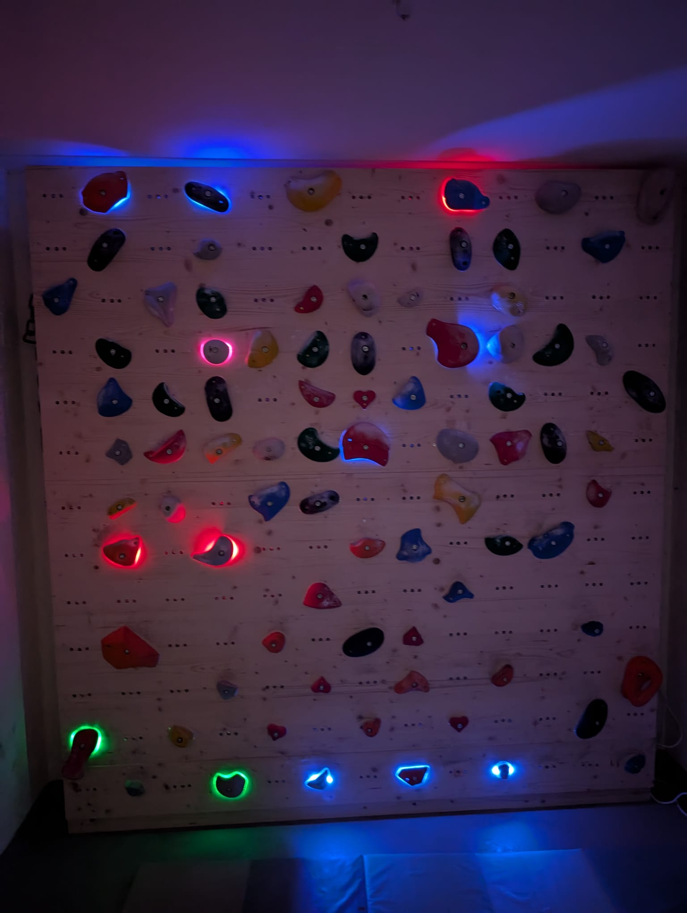

# CRUX App to WLED Bridge
This small python script is a quick and dirty Crux App to WLED Bridge. The workflow is following:

## Differences from raphirm/cruxwledbridge

This repository is based on [raphirm/cruxwledbridge](https://github.com/raphirm/cruxwledbridge), but extends it in the following areas:

- **Deployment and configuration:** Three Docker Compose variants cover direct access, a bundled nginx proxy, and an existing external proxy. Database and configuration data are persisted in dedicated directories, sub-path hosting is supported through `APP_PATH_PREFIX`, and containers use the host timezone for log timestamps. An empty config mount is initialized automatically; unchanged example values, missing templates, and unwritable mounts produce clear startup errors.
- **Flexible LED hardware:** Multiple WLED controllers can be configured with non-overlapping physical LED ranges. `hole2LEDS` separates logical CRUX hold IDs from physical LEDs, allowing unused LEDs and multiple LEDs per hold.
- **Three-step wall setup:** Define grip positions, LED positions and cable order in separate panels. LED geometry can copy a grip grid, shift below it in its perspective plane, use the complementary staggered positions, or use independent grids and extra bores. Cable patterns work per grid or per selected subgrid; mouse and touch paths support pause, resume, saved partial paths and repeated undo. Hidden cable LEDs can be entered by number or inserted between connected visible LEDs, with gaps shown on the zoomable image. Stable bore references preserve positions and manual grip exceptions when the cable order changes. Spatial above/below associations can cross grid boundaries on the same wall plane; CRUX and MoonBoard share the activated mapping. Drafts remain separate from live lighting.
- **Per-grid grip-to-LED calibration (legacy mode):** Grid points describe grip holes. Virtual MoonBoard positions always match the nearest grip, without a general preference for lower image points. Each wall grid has an **LED assignment for this grid** selector: unchanged (default), one grid row below, or one grid row above. The explicit offset is applied after grip matching, before `hole2LEDS`, for both MoonBoard mapping and CRUX route lighting. In staggered rows, corresponding positions are counted from the left, independent of cable direction and start corner. Missing/excluded targets and manual extra holes retain their original assignment. The setting does not move corners, grip labels or cable IDs, or change other grids. Save the wall grids, then recalculate and update existing MoonBoard mappings; saved LED lists are not rewritten automatically.
- **Wall mapping:** Standard and alternating grids are supported, including odd column counts and either alternating-row offset. A projective homography maps the grid between the four selected corners so photographed walls retain perspective-correct spacing. A wall image may contain multiple independently configured grids, managed as reorderable tabs for walls that turn a corner. The first tab starts at LED 0 and every following tab continues the global LED numbering. The LED cable may start in any corner and snake horizontally or vertically within each grid. New or geometrically changed grids automatically disable positions without a nearby CRUX hold by default; this behavior can be switched off and is stored separately for each grid. Every position can still be manually reactivated or disabled, with hold labels remaining attached to their physical grid positions while LED IDs are renumbered. Individual off-grid holes can be added by clicking the wall image, inserted before a chosen grid position or at the end of the grid's cable order, disabled/reactivated, or removed. Their coordinates and stable IDs are persisted per grid; automatic empty-position exclusion never disables manually added holes. Structural grid positions and above/below relationships remain unchanged, and extra holes participate in CRUX and virtual MoonBoard mapping. Saved corners, layout settings, tab order, exclusions, and automatic-selection choices can be reopened and edited. A separate virtual MoonBoard page starts with a 12-row by 11-column Mini grid and can switch to an 18-row by 11-column Standard grid. Mini 2020/2025 and Standard 2010/2016/2024/Masters 2017/Masters 2019 setups are selectable. Named installations are stored in SQLite and several mappings—including multiple installations of the same setup—can coexist on one CRUX wall. Each saved position retains its MoonBoard label, CRUX hold IDs, logical wall LED, and physical `hole2LEDS` result for later catalog imports. The original temporary workflow remains available: place any independent grid across all saved wall grids, choose its start corner and cable path, calculate without saving, and copy the comma-separated physical cable LED list. The resulting physical LEDs can be lit temporarily for visual verification; ending the preview restores the previous route or off state. Mappings are scoped by wall ID so identical hold IDs on different walls do not collide.
- **User interface:** The root URL is an English/German overview page linking to wall setup, lighting controls, general settings, and a system-status page. A successfully loaded gym slug is remembered locally in the browser as a directly accessible favorite and can be removed again. The status page checks the database and CRUX API, shows WLED reachability, firmware version, configured and reported LED counts, response time and recent errors, and offers read-only controller test buttons.
- **Lighting controls and events:** Dark and bright wall modes are available, with independent 10%–100% controls for selected boulder LEDs, LEDs illuminating a hold from above in the combined above-and-below direction, and the white background in bright mode. In above-only mode, upper LEDs use the regular boulder brightness; the separate upper-brightness control is enabled only for above-and-below mode. Route holds can be illuminated from below, from above, or from both sides. In legacy mode, a standard grid uses the same column one row higher for above-lighting; because alternating rows use opposite column parities, an alternating grid uses the same column two rows higher. If that exact position has no active LED, the hold retains its below light instead of substituting a lateral or more distant LED. One save button stores the complete lighting configuration. Lighting mode, all brightness values, hold-lighting direction, celebration effect, and the energy-saving timeout use a generic SQLite settings store that can also accept future settings, so they survive restarts. The timeout can switch an illuminated route off after a configurable number of minutes; `0` keeps it on, and every newly viewed route restarts the timer. A `climb.sent` gym webhook can trigger a configurable celebration effect, which can be disabled and restores the latest viewed climb afterward. Every WLED request has a short configurable timeout; a failed controller is logged and skipped without blocking the remaining controllers. Route webhooks distinguish full, partial, and failed output and expose the last request, last complete success, and last error on the status page. Access logging includes useful webhook details without duplicate Uvicorn access entries.
- **Automated coverage:** Regression tests cover configuration startup, mapping layouts, multi-controller output, UI navigation, lighting modes, celebrations, and webhook behavior.
- **Mapping verification and editing:** Physical LED previews, route output, and single-LED tests explicitly address segment 0 over the configured controller range with grouping, spacing, offset, reverse, and mirroring reset. Power and brightness are applied before individual colors, and each frame clears the previous one. The wall editor has a prominent **Add individual holes** button with readiness guidance; the virtual MoonBoard page links directly to that editor section.
- **Local Windows development:** `dev.ps1` provides Python 3.12 setup, environment checks, the complete Python/Node test suite, and a localhost server with a project-local SQLite database. Virtual environments, package caches, and temporary files stay inside the project. Tested Windows dependencies are recorded separately from the container requirements. The additional lowercase `license` file is retained as `LICENSE.legacy` to avoid a Windows filename collision with `LICENSE`.

> **Maintenance rule:** Whenever behavior in this repository is added, removed, or changed relative to `raphirm/cruxwledbridge`, update this section in the same commit.

## Local development on Windows

Use Python 3.12, matching the Docker image. In PowerShell, from this folder:

```powershell
.\dev.ps1 Setup
.\dev.ps1 Check
.\dev.ps1 Test
```

Setup creates `.venv`, installs `requirements.txt` using the tested Windows/Python 3.12 versions in `requirements-dev.lock.txt`, and copies `config/config.example.py` to `config/config.py` only if the latter is missing. Package downloads require network access. It can use the Python runtime bundled with Codex; otherwise specify an installed interpreter with `.\dev.ps1 Setup -Python C:\path\to\python.exe`. The interpreter used afterward is always `.venv\Scripts\python.exe`; activating the environment is unnecessary. If the underlying Python installation is removed, recreate `.venv` with an available Python 3.12 installation.

`Test` runs the existing `unittest` suite with mocked configuration and an in-memory database; no real CRUX token or WLED controller is needed. Node.js is required for the JavaScript UI test. The helper uses Codex's bundled Node when available, then the Node installation on PATH; an explicit path can be supplied with `-Node C:\path\to\node.exe`. Missing Node fails clearly instead of silently skipping the UI test. `Check` verifies Python imports and package compatibility without loading personal configuration.

The test command has a 120-second timeout with a diagnostic traceback. In a restricted Windows sandbox, Python's internal `asyncio` loopback socket may be blocked even though external services are mocked. In that case, run the tests in an approved execution context that permits local sockets; adding writable folders does not resolve this restriction.

For a real local server, edit the ignored `config/config.py` with your CRUX token, controller ranges, and LED mapping, then run:

```powershell
.\dev.ps1 Run
```

Open `http://127.0.0.1:8000/` (or select a port with `-Port 8001`). The server runs in the foreground until Ctrl+C and stores its data in `db/app.db`. Local lighting actions use the configured controllers. The Docker configuration and production database are independent. No credentials are included in the repository.

The helper confines temporary files and the pip cache to `.cache`, restores process environment variables afterward, and works when invoked from another directory. `.venv`, `.cache`, local databases, and `.env` are excluded from Git and Docker build contexts. If PowerShell blocks an unsigned script, run `powershell -NoProfile -ExecutionPolicy Bypass -File .\dev.ps1 Test` (or `Setup`, `Check`, `Run`); this applies only to that process.

To deliberately update dependencies, install the updated requirements in `.venv`, regenerate `requirements-dev.lock.txt` with `python -m pip freeze`, then run the full test suite and `pip check` before committing the new versions. The lock is a Windows development snapshot, not a cross-platform production lock.

## Setup Container
To get the bridge running, I recommend using a proxy for authenticating all URLs except `https://<bridge>/viewed`.

Three commented Docker Compose examples are included:

- `docker-compose.no-proxy.yml`: publishes the bridge directly at `http://<host>:8080/`.
- `docker-compose.proxy.yml`: runs `nginxproxy/nginx-proxy` in the same Compose project and publishes the bridge at `http://<host>:8080/cruxwledbridge/`.
- `docker-compose.external-proxy.yml`: the previous setup, renamed to make it explicit that it joins an already existing `nginx-proxy` network and publishes `https://<VIRTUAL_HOST>/cruxwledbridge/`.

Start the example you want with `docker compose -f <filename> up -d --build --force-recreate`, for example `docker compose -f docker-compose.no-proxy.yml up -d --build --force-recreate`.

All examples persist the SQLite database at `/code/db/app.db` and mount the host `config` directory at `/code/app/config`. On startup, an empty config mount is initialized automatically: the bridge first copies `config.py` bundled into the image; if that file was not present while the image was built, it copies `config.example.py` as `config.py` instead. An existing `config.py` in the mount is never overwritten.

With the example Compose paths, the bridge reads `/share/Docker-Appdata/cruxwledbridge/config/config.py` on the host as `/code/app/config/config.py` in the container. If the generated file came from `config.example.py`, the bridge exits until you set the CRUX token and replace the example WLED controller (`192.0.2.10`, LEDs 0-399) with your controller configuration. Adjust the generated file and restart the bridge. If neither `config.py` nor `config.example.py` was available in the built image, or the mounted directory is not writable, the bridge prints an error and exits. Make sure the host directories are readable or writable as required by container user `1018:100`. The read-only `/etc/localtime` mount makes log timestamps use the Docker host's local timezone instead of hard-coding a timezone in the application.

For `docker-compose.proxy.yml`, `VIRTUAL_HOST` defaults to `localhost`; override it if you access the proxy with another hostname. This example mounts the Docker socket read-only so `nginx-proxy` can discover the bridge container. Docker-socket access is security-sensitive even when mounted read-only, so only use a trusted proxy image.

For `docker-compose.external-proxy.yml`, set the public hostname in a local `.env` file, for example `VIRTUAL_HOST=bridge.example.com`. The file is ignored by Git. `PROXY_NETWORK` must be the Docker network used by the external proxy and defaults to `nextcloud_proxy-tier`. Find the actual name with `docker network ls` and override it when needed, for example with `PROXY_NETWORK=myproject_proxy-tier docker compose -f docker-compose.external-proxy.yml up -d --build --force-recreate`.

Both proxy examples require nginx-proxy support for `VIRTUAL_PATH` and `VIRTUAL_DEST`. In the external-proxy example, the existing proxy is also responsible for TLS/certificates.

## Setup Bridge
1) Create a Gym in the CRUX App and create a wall. 
2) Get your API key from the CRUX App and insert it into `config/config.py` (there is a `config/config.example.py` as an example)
3) Configure `wled_controllers` and `hole2LEDS` in `config/config.py`. Each controller has an inclusive range of global physical LED IDs. Wall Creation assigns logical hole IDs according to the selected cable direction. `hole2LEDS` maps each logical hole to its actual physical LED IDs. This allows gaps for unused LEDs and multiple LEDs at one hold. For example, `{0: [0], 1: [2, 3]}` leaves physical LED 1 unused and assigns physical LEDs 2 and 3 to logical hole 1.
2) open `https://<bridge>/cruxwledbridge/listwalls?gym=<gymslug>` and select the wall you want to map
3) Wall setup opens with **1 · Grip positions**, **2 · LED positions**, and **3 · Cable order**. Define and save grip geometry first, align the independent LED layer second, then configure cable order and review the associations. The detailed workflow is below. Existing wall settings open without being activated or overwritten. Afterward, open **Virtual MoonBoard**, choose Mini/Standard and the setup, place its four corners, and save the mapping. Several named MoonBoard installations can be stored on the same wall. **Calculate physical LED list** is read-only; **Light mapped LEDs** previews orange and **Stop test** restores the previous lighting.
4) Configure a user webhook for `climb.viewed` --> `https://<bridge>/cruxwledbridge/viewed`. If you are a gym admin, also configure a gym webhook for `climb.sent` --> `https://<bridge>/cruxwledbridge/sent` to trigger a short celebration across all LEDs whenever a climb is sent.
5) When you press on a climb, it should light up the right holes on the wall. Hold mappings are stored as `<wall_id>_<hold_id>`, so the webhook payload must include `payload.wall_id`.
6) Configure wall lighting at `https://<bridge>/cruxwledbridge/wall_lighting`: dark lights only the current boulder, while bright additionally lights unused LEDs white. Separate sliders set the boulder, above-hold, and white-background brightness from 10% to 100%; their defaults are 100%, 100%, and 20%. The above-hold slider is active only with the combined above-and-below direction. Above-only mode uses the regular boulder brightness for its upper LEDs, while below-only mode has no upper LEDs. In legacy mode, route holds may use the LED below, the LED in the same grid column above, or both. An activated independent LED layer instead uses the spatial associations described below, without the legacy fallback. In a standard grid that position is one row higher; in an alternating grid it is two rows higher because adjacent rows use opposite column parities. If that exact position is excluded or outside the grid, the hold uses its own below LED; the bridge never substitutes a lateral or more distant LED. The same page selects the `climb.sent` celebration: moving rainbow (default), fireworks, color sparkles, rainbow party, or off. Use the single button at the bottom to save the mode, all brightness values, hold-lighting direction, and celebration together. These settings are stored in SQLite and survive restarts. A celebration runs for 3 seconds by default, then the latest viewed boulder is restored; set `celebration_duration_seconds` in `config.py` to change the duration. The combined API is `POST /cruxwledbridge/wall_lighting_settings` with `{"mode":"bright","bright_brightness_percent":20,"boulder_brightness_percent":100,"above_brightness_percent":100,"hold_lighting_direction":"both","celebration_effect":"rainbow"}`; the previous mode and celebration endpoints remain available and now persist their changes too. At `https://<bridge>/cruxwledbridge/settings`, the energy-saving timeout controls how many minutes a viewed route remains illuminated. The value uses the same generic SQLite settings store, every `climb.viewed` restarts the timer, and `0` disables automatic switch-off.
7) Open `https://<bridge>/cruxwledbridge/status` for live diagnostics. Controller checks use WLED's read-only `/json/info` endpoint and do not change the current route. Set `wled_request_timeout_seconds` in `config.py` to change the per-request timeout (default: 2 seconds). When one controller is unavailable, other configured controllers are still updated; `/viewed` returns status `partial` with HTTP 207, or HTTP 503 when no controller could be updated.
8) enjoy climbing!

### Adding individual holes

In **1 · Grip positions**, select a grid, save its regular geometry, then choose **Add individual holes** and click the extra grip-hole centres. Finish adding and save all grip grids. Extra holes belong to the grip geometry only.

In **2 · LED positions**, select an LED grid and choose **Place individual LED**, then click the actual LED bore. Its fixed position is independent of the grip grid. Use **3 · Cable order** to include it in a free path or a selected subgrid; otherwise it follows the grid pattern. Existing insertion anchors are retained when importing older layouts. Changing row/column counts or alternating parity clears that grid's obsolete cable selections, disabled positions and extra-hole anchors; the extra bores themselves remain.

The bridge owns segment 0 on each controller as one continuous 1D cable, starting at local LED 0. Direct output resets that segment's transformations so a mapped physical ID is not shifted, grouped, or reversed again. Configure cable direction in the bridge. Additional overlapping WLED segments and firmware-level 2D matrices/LED maps are separate transformations and should not be used for this 1D setup. See WLED's [individual LED control documentation](https://kno.wled.ge/interfaces/json-api/#per-segment-individual-led-control).

## Hardware used
I use following hardware on the wall:
- LED Strips: WS2811 DC5V/12V 12mm Vollfarb-LED-Pixel-Lichterkette (https://de.aliexpress.com/item/1005009421177129.html?spm=a2g0o.order_list.order_list_main.25.6c195c5f9ulSae&gatewayAdapt=glo2deu)
- LED Controllers: GLEDOPTO ESP32 WELD LED Controller (https://de.aliexpress.com/item/1005009615006206.html?spm=a2g0o.order_list.order_list_main.20.6c195c5f9ulSae&gatewayAdapt=glo2deu)
- Appropriate 5v power supplies
- Under every hold i 3d printed a transparent pla washer to spread the LED Light. I also used a mirrorfilm on the backside of the hole to bounce off light. 
- I drilled 2x 12mm holes next to the screw-hole, with a 2.5cm spacing in between - very similar to the kilter layout. 

if you have any more questions you can reach me in the CRUX App Discord.

## Multiple WLED controllers

Add one entry per controller. Ranges must not overlap:

```python
wled_controllers = [
    {"ip": "192.0.2.10", "start": 0, "end": 399},
]
wled_request_timeout_seconds = 2.0
```

## Setup-Picture
Thats how it looks like after beeing finished:



## Separate grip and LED geometry

Open the wall normally from the wall list (`/wallcreation?id=<wall_id>`) or reopen the cached setup at `/ledmapping?id=<wall_id>`. Both show the same three-step editor; the latter does not fetch CRUX again.

1. **Grip positions:** Set the grid corners, rows/columns and alternating parity on the actual grip holes. Add individual grip holes, disable absent positions and **Save all grids** inside this panel. Each grip grid has independent geometry. All image panels support wheel/pinch zoom, zoom buttons and dragging to pan. Saving here refreshes the parent editor without replacing pending LED edits.
2. **LED positions:** Choose a saved grip grid and derive new LED positions **Unchanged**, **Below with spacing**, or **Complementary staggered positions** (opposite top-row parity). The below offset is measured in grip-grid row intervals and follows the perspective plane, including individual holes. Alternatively create an independent LED grid, choose its four corners, change its counts/parity and add individual LED bores. LED grids may include additional top/bottom rows or extend across grip-grid boundaries. Place points on actual visible LEDs. The initial unactivated draft imports grip geometry and known ascending cable gaps from `hole2LEDS`; review this starting point before activation.
3. **Cable order:** Choose a snake pattern and start corner per LED grid. **Earlier/Later on cable** changes grid order. To subdivide a grid, choose **Select subgrid in image**, tap its LED points or drag a rectangle, then **Create subgrid from selection**. Subgrids have independent patterns and an ordered list. Their selections cannot overlap; remaining bores follow the parent grid pattern. Excluded positions do not change the original stripe directions.

For a free path, choose **Start a new free cable path**, then tap LEDs or drag/swipe along them in cable order. Intermediate LEDs along a swipe are included. **Pause drawing** or **Pan image** interrupts the path; **Continue cable path** resumes it. You can zoom with two fingers while drawing without assigning those touches. Repeated **Undo last step** removes assignments one at a time and also reverses gap/pattern/subgrid changes made in this session. **Save draft** preserves unfinished paths across reloads; after reopening, undo can still remove the saved path's final assignments. **Continue cable path** on a pattern retains its order as the starting free path. **Use grid patterns** explicitly replaces a free path and is undoable.

Physical IDs are zero-based global controller addresses. In pattern mode set the first grid's start, leaving later starts blank for continuous numbering. Explicit starts support separate controller ranges. A free path uses **First LED of free path** for its first grid and respects an explicit start on first entering another grid. Every visible bore must be connected before activation; omitted bores should be disabled in step 2.

Select a cable connection or its two directly connected endpoints in the image, or enter their current physical IDs and choose **Show connection**. **Insert skipped LEDs** adds the requested count between them and shifts subsequent numbers; **Remove inserted LEDs** removes that connection's inserted count. Absolute IDs entered under **Skip hidden LEDs** remain separate. These two inputs form a union: an absolute skip already inside an inserted gap is counted once. Gaps appear as dashed connections with a diamond and a label such as `+2 [101–102]`; leading/unplaced absolute skip IDs are listed on the image too. Disabled visible bores compact numbering, whereas skipped IDs still exist electrically.

Give grip and LED grids on the same flat wall plane the same **Wall surface** ID. All copied grids initially use `1`; different faces around a corner need different IDs. Matching can cross grids on a surface, never between surfaces. Lateral tolerance is measured in column intervals; maximum vertical distance uses the spacing of vertically aligned grips (two staggered rows). Defaults are 0.35 and 0.9. One-row grids use their quadrilateral's height as the reference. Unchanged copied geometry is a starting point: LEDs must be aligned with the actual bores before reviewing above/below associations.

In step 3, **Calculate associations** and **Review associations** show upper/lower connections and missing or ambiguous results. Missing LEDs remain unassigned; ambiguous matches block activation. Manual exceptions bind to fixed bore references, so cable renumbering cannot silently move them to another bore. **Light selected grip** tests below/above/both; **Stop test** restores previous lighting. Tests remain blocked during celebrations. **Save draft** does not affect routes; **Activate reviewed associations** enables the new layer for subsequent route events. Invalid addresses, incomplete cable paths and ambiguous associations block activation. Missing edge LEDs are allowed. **Use legacy mapping** restores the old mapping while retaining the draft. Controller settings and `hole2LEDS` are never rewritten.

CRUX and MoonBoard use the shared above/below setting from Wall Lighting. A saved MoonBoard installation recalculates its displayed LED list when opened without overwriting its saved snapshot; **Save mapping** updates the snapshot. Lists keep an empty field for unmapped positions and `/` between multiple LEDs for one position. Already-resolved physical IDs bypass the legacy logical mapping once, including route restoration.

The editor API is `POST /ledmapping` with `wallid`, `layout` and action `calculate`, `draft`, `activate` or `deactivate`. Calculations never contact WLED. `GET /ledmapping/data` and `GET /ledmapping/grips` load saved grip data; `POST /ledmapping/derive` derives a new grid without saving it. The layout remains inside the wall's JSON settings, with no database schema migration or additional dependencies. Old LED layouts preserve their point identities and cable ordering when opened in the new editor.
